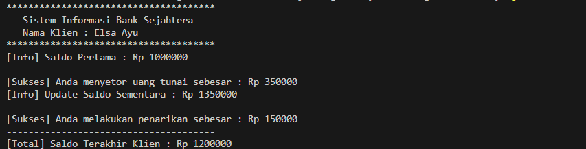

# Tugas Array

## Bio
- **Nama: Elsa Ayu Ramadani**
- **NIM: F1D02410005**

## Deskripsi Proyek
Program Java ini merupakan penyelesaian tugas Pemrograman Berorientasi Objek (PBO) yang berfokus pada penerapan Array dan relasi *Has-A*. Terdapat tiga kelas utama yang menyusun logika sistem: `Account` untuk manajemen saldo tabungan, `Customer` untuk pencatatan data nasabah, dan `Bank` sebagai wadah penyimpanan daftar nasabah dalam bentuk Array.

Seluruh alur pendaftaran nasabah baru beserta simulasi transaksinya dieksekusi langsung secara sekuensial melalui kelas `BankDemo.java`. Tidak ada *library* eksternal tambahan yang digunakan dalam kode ini.

## Hasil Eksekusi Program
